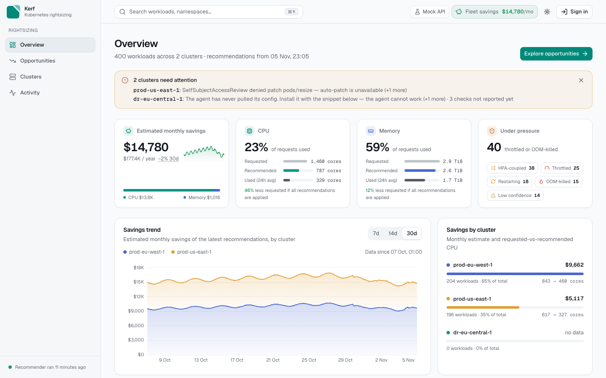
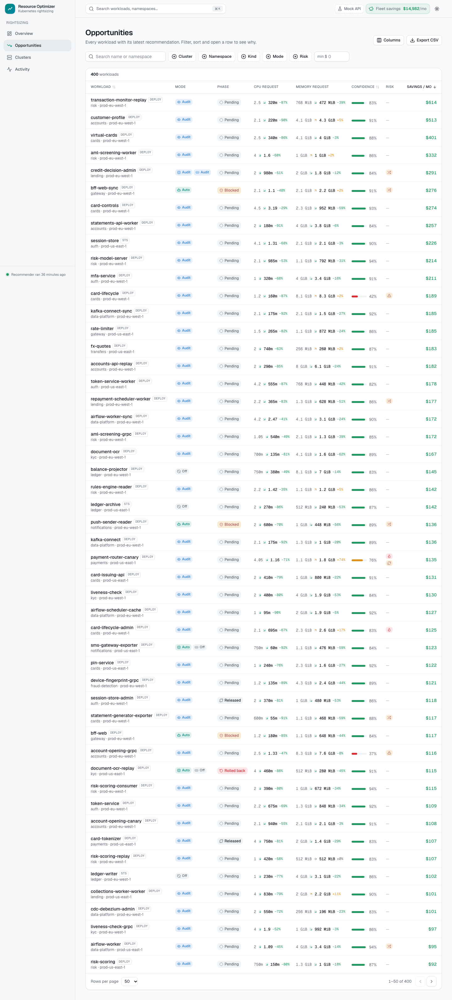
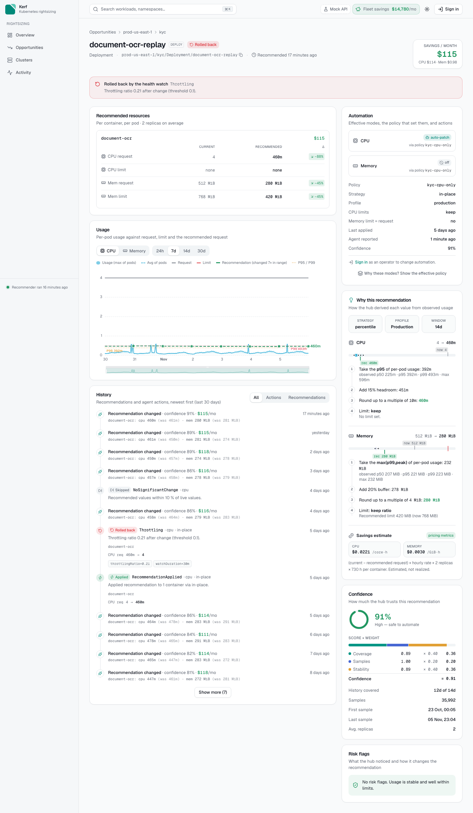
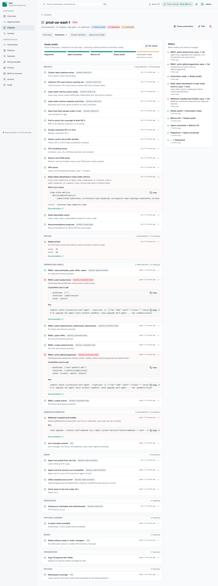
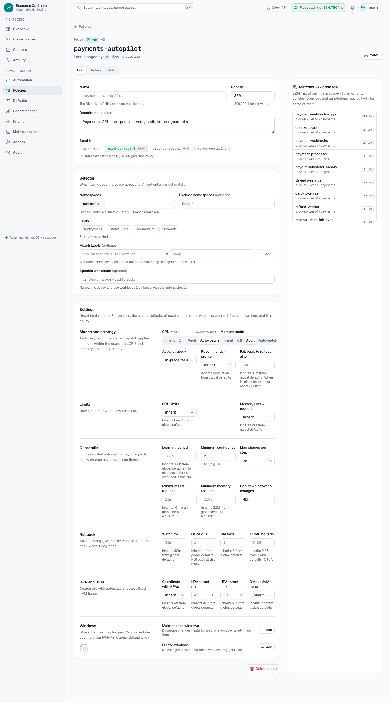
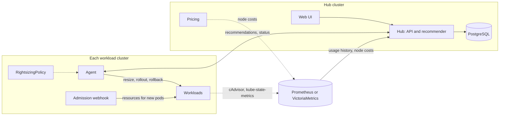

<p align="center">
  <picture>
    <source media="(prefers-color-scheme: dark)" srcset="docs/branding/kerf-logo-on-dark.svg">
    
  </picture>
</p>

<h3 align="center">Trim what your containers don't use.</h3>

<p align="center">
  <a href="https://github.com/kerf-dev/kerf/actions/workflows/ci.yaml"></a>
  <a href="https://github.com/kerf-dev/kerf/releases"></a>
  <a href="LICENSE"></a>
  <a href="https://goreportcard.com/report/github.com/kerf-dev/kerf"></a>
  <a href="https://artifacthub.io/packages/helm/kerf/kerf"></a>
</p>

<p align="center">
  <a href="https://getkerf.dev">Website</a> ·
  <a href="#quick-start">Quick start</a> ·
  <a href="docs/install/eks.md">Install on EKS</a> ·
  <a href="#how-kerf-compares">Comparison</a> ·
  <a href="docs/README.md">Documentation</a> ·
  <a href="CONTRIBUTING.md">Contributing</a>
</p>

**Kerf is an open-source, self-hosted Kubernetes rightsizing tool.** It recommends CPU and memory requests and
limits for every container from your Prometheus or VictoriaMetrics history, prices the savings per node type,
and, where you allow it, applies the change with an in-place pod resize or a rollout, inside your maintenance
windows and with automatic rollback. Everything runs in your own clusters.

The name: a *kerf* is the width of a saw cut, the precise amount a cut removes.

<picture>
  <source media="(prefers-color-scheme: dark)" srcset="docs/branding/hero-dark.png">
  
</picture>

## Why Kerf

Many clusters reserve far more CPU and memory than their pods use, and every reserved core is node capacity
you pay for. Kerf finds the difference, prices it, and closes it at the pace you choose.

- **Runs in your clusters.** One Helm chart installs the hub, the web UI, the agents and the webhook. Usage
  data stays in your Prometheus and your PostgreSQL. Agents pull from the hub, so the hub never holds write
  credentials to a workload cluster.
- **Changes things, carefully.** Choose `off`, `audit` or `auto-patch` per workload and per resource, so you
  can automate CPU and keep memory in audit. Changes go in as an in-place resize, a rollout, or a deferred
  patch inside a maintenance window. Guardrails cap each decrease, freeze windows block changes, and a change
  followed by OOM kills, restarts or CPU throttling is rolled back automatically.
- **Speaks money.** Savings per workload, namespace and cluster, priced per node type from the AWS price list
  (on-demand and spot) or your own price table.
- **Knows the workload.** HPA-coupled workloads get their requests and HPA target changed together. JVM
  containers get heap-aware memory. Single-replica workloads and `OnDelete` StatefulSets change without
  downtime.
- **Fits GitOps.** In-place resizes leave the pod template alone, so Argo CD sees no drift. Policies live in
  the UI or as `RightsizingPolicy` resources in Git, per cluster.

## Features

<table>
<tr>
<td width="50%" valign="top">

**Opportunities.** Every workload ranked by estimated monthly savings, with the current, recommended and
used values for CPU and memory, the confidence, and bulk actions.

</td>
<td width="50%" valign="top">

**Workload detail.** Usage history against requests and the recommendation, the effective policy and where
it came from, and a timeline of every change and rollback.

</td>
</tr>
<tr>
<td valign="top">
<picture>
  <source media="(prefers-color-scheme: dark)" srcset="docs/screenshots/opportunities-dark.png">
  
</picture>
</td>
<td valign="top">
<picture>
  <source media="(prefers-color-scheme: dark)" srcset="docs/screenshots/workload-rolled-back-dark.png">
  
</picture>
</td>
</tr>
<tr>
<td valign="top">

**Cluster onboarding.** An add-cluster wizard that renders the install command, then readiness checks:
Registered → Agent connected → Metrics OK → Ready for audit → Automation ready.

</td>
<td valign="top">

**Policies and admin.** A policy editor with a preview of what changes, defaults, maintenance windows, metrics
sources, prices, users and API tokens, an audit log, and a switch that pauses automation for a cluster or the
whole fleet.

</td>
</tr>
<tr>
<td valign="top">
<picture>
  <source media="(prefers-color-scheme: dark)" srcset="docs/screenshots/cluster-readiness-dark.png">
  
</picture>
</td>
<td valign="top">
<picture>
  <source media="(prefers-color-scheme: dark)" srcset="docs/screenshots/admin-policy-editor-dark.png">
  
</picture>
</td>
</tr>
</table>

Also included: Grafana dashboards and Prometheus alerts, a recommendation simulator, high availability for the
hub (leader election on PostgreSQL), External Secrets support, NetworkPolicies, and multi-arch images signed
with cosign.

## How it works



1. The **hub** reads each container's CPU and memory usage from your metrics store and computes requests and
   limits from a percentile of the history plus headroom (profiles `dev`, `production`, `high-availability`).
2. The **pricing** service prices every node from its instance type and capacity type, so each recommendation
   has a monthly saving in dollars.
3. The **agent** in each workload cluster pulls recommendations, resolves the `RightsizingPolicy` that applies,
   checks the guardrails, applies the change, watches the workload's health, and rolls back when needed.
4. The **webhook** gives new pods the recommended resources, so a scale-up or a restart keeps the new values.

## Quick start

**Try it on your laptop** (Docker, [kind](https://kind.sigs.k8s.io/) or [k3d](https://k3d.io/), kubectl and helm; 4 CPUs
and 8 GiB free). One command creates a cluster, installs Kerf with demo workloads and a generated usage history,
and prints the URL and the admin password of a UI that shows priced recommendations:

```bash
git clone https://github.com/kerf-dev/kerf && cd kerf
hack/quickstart.sh          # about 10 minutes the first time
hack/quickstart.sh down     # removes everything it created
```

It is for evaluation only: a single PostgreSQL pod, a self-signed webhook certificate and generated data.
[The quickstart guide](docs/quickstart.md) says what it installs and how to move to a real install.

**See the UI with a sample fleet** (no cluster needed; Node.js 22 and `make`):

```bash
make web-dev        # open http://localhost:5173
```

**Install on your clusters.** One chart; `global.mode` picks the role of each cluster:

```bash
# the central cluster: hub, web UI, pricing
helm install kerf oci://ghcr.io/kerf-dev/kerf/charts/kerf --version <version> \
  -n kerf --create-namespace -f values-hub.yaml       # global.mode: hub

# each workload cluster: agent, webhook, CRDs (the add-cluster wizard prints the full command)
helm install kerf oci://ghcr.io/kerf-dev/kerf/charts/kerf --version <version> \
  -n kerf --create-namespace -f values-spoke.yaml     # global.mode: spoke
```

Every cluster starts in `audit`: Kerf recommends and changes nothing until you turn on `auto-patch`.
The [EKS guide](docs/install/eks.md) walks through the whole install, with example values in
[deploy/examples/eks](deploy/examples/eks). `global.mode: all` installs everything in one cluster.

**Requirements:** Kubernetes 1.35 (tested; in-place resize is GA there), Prometheus or VictoriaMetrics with
cAdvisor and kube-state-metrics (Thanos, Mimir and Amazon Managed Service for Prometheus also work),
cert-manager in each workload cluster (the webhook's certificate), and PostgreSQL 12 or later for the hub.

## How Kerf compares

Kerf takes ideas from the tools below. They are good tools; pick the one that fits.

| | License | Your data stays in your infrastructure | Applies changes | In-place resize | Rollback on bad health | Savings in $ | HPA and JVM aware |
|---|---|---|---|---|---|---|---|
| **Kerf** | Apache-2.0 | ✓ | ✓ policies, maintenance windows | ✓ | ✓ | ✓ | ✓ both |
| [Vertical Pod Autoscaler](https://github.com/kubernetes/autoscaler/tree/master/vertical-pod-autoscaler) | Apache-2.0 | ✓ | ✓ evict and webhook | ✓ `InPlaceOrRecreate` | – | – | not with an HPA on the same metric |
| [Goldilocks](https://github.com/FairwindsOps/goldilocks) | Apache-2.0 | ✓ | through VPA, opt-in | through VPA | – | – | – |
| [Robusta KRR](https://github.com/robusta-dev/krr) | MIT | ✓ CLI; the UI is SaaS | optional webhook, with a Robusta account | – | – | – | `--allow-hpa` |
| [IBM Kubecost](https://www.ibm.com/products/kubecost) | commercial, free tier | ✓ self-hosted option | Kubescaler (alpha) | – | – | ✓ | – |
| [StormForge](https://www.cloudbolt.io/stormforge/) | commercial | metrics go to SaaS | ✓ | ✓ | ✓ | ✓ | ✓ both |
| [PerfectScale](https://www.perfectscale.io/) | commercial, free tier | ✓ self-hosted option | ✓ maintenance windows | ✓ | – | ✓ | JVM; HPA advice |
| [CAST AI](https://cast.ai/) | commercial | SaaS console | ✓ | ✓ | – | ✓ | ✓ both |

✓ = documented. – = not found in their public docs on 2026-11-05, which is not proof that it's missing.
[Sources and details](docs/branding/comparison.md). Corrections are welcome: open an issue.

**In short:** VPA or Goldilocks suit one cluster that you watch closely. KRR gives a quick report from
Prometheus. StormForge, PerfectScale and CAST AI automate most of what Kerf does, as commercial products with
vendor support. Kerf is for teams that want that automation open source and entirely inside their own
infrastructure.

## FAQ

**What is Kubernetes rightsizing?**
Setting each container's CPU and memory requests and limits to what it actually uses, plus headroom.
Requests decide how many pods fit on a node, so over-requested pods waste nodes you pay for, and
under-requested pods get throttled or OOM-killed.

**Can I use Kerf with the Horizontal Pod Autoscaler?**
Yes. When an HPA scales a workload on CPU or memory utilization, Kerf changes the requests and the HPA's
utilization target in one change, so the HPA keeps scaling at the same usage as before.

**Does Kerf send data anywhere?**
No. Kerf reads metrics from your Prometheus-compatible store and keeps its state in your PostgreSQL. The only
calls outside your clusters go to the AWS Pricing and EC2 APIs, and only when you choose AWS prices.

**Does it work outside EKS?**
The recommender, agent and webhook use standard Kubernetes APIs. EKS 1.35 is the tested platform; on other
clusters, use a static price table and expect to report what you find.

**Is it ready for production?**
Kerf is new (0.x). Run it in `audit` first, then turn on `auto-patch` for one namespace and watch the activity
log. The [roadmap](#roadmap) lists what comes next.

## Documentation

- [Install on Amazon EKS](docs/install/eks.md) and the [chart reference](deploy/charts/kerf/README.md)
- [Documentation index](docs/README.md): contracts (CRDs, hub API, metrics, events, readiness), release
  process
- [Architecture](docs/architecture.md): how the components fit together and the main design choices
- [CHANGELOG.md](CHANGELOG.md) and [GitHub Releases](https://github.com/kerf-dev/kerf/releases)

## Roadmap

Next: notifications (Slack, Teams), Cost and Usage Report prices (Savings Plans, reserved instances), realized
savings from node cost, OIDC sign-in, and mTLS between agents and the hub. Ideas and requests are welcome in
[discussions](https://github.com/kerf-dev/kerf/discussions).

## Contributing

Bug reports, docs fixes and code are welcome. [CONTRIBUTING.md](CONTRIBUTING.md) explains the local setup:
`make web-dev` runs the UI against a mock API in a minute, and `make dev-up` starts three local k3d clusters
with metrics and sample workloads. Look for issues labelled
[`good first issue`](https://github.com/kerf-dev/kerf/labels/good%20first%20issue). Please follow the
[code of conduct](CODE_OF_CONDUCT.md).

## Security

Report vulnerabilities privately through [GitHub security advisories](https://github.com/kerf-dev/kerf/security/advisories/new);
see [SECURITY.md](SECURITY.md). Everything else: <admin@getkerf.dev>.

## License

Kerf is licensed under the [Apache License 2.0](LICENSE).
