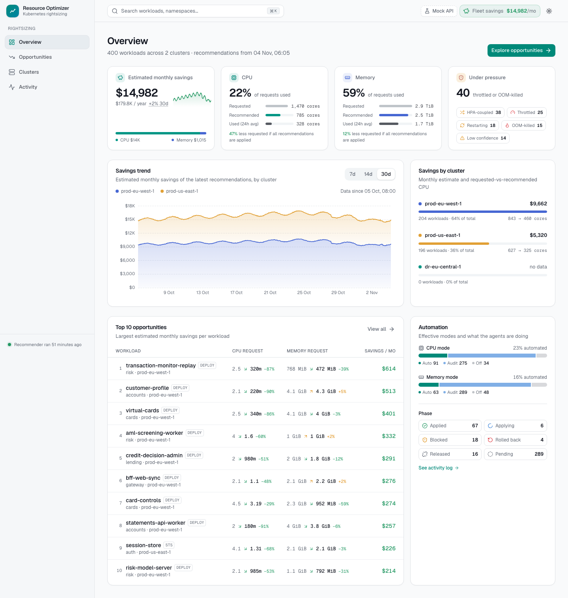

# resource-optimizer

Kubernetes rightsizing that you run yourself. It measures what every container really uses, recommends
CPU and memory requests and limits, prices the difference per node type, and, where you allow it,
applies the change for you: an in-place pod resize or a rollout, with guardrails and automatic rollback.

[](LICENSE)



## What it does

- **Recommends** requests and limits per container from Prometheus or VictoriaMetrics history
  (percentiles, OOM and throttling signals, JVM heap awareness, HPA coordination).
- **Estimates savings** per workload, namespace and cluster from node prices (AWS price list or your own table).
- **Automates, per policy:** `off`, `audit` (recommend only) or `auto-patch`. Auto-patch uses in-place
  resize where Kubernetes supports it, or a rollout; it respects maintenance and freeze windows, handles
  single-replica workloads without downtime, and rolls back a change that makes a workload unhealthy.
  A mutating webhook gives new pods the recommended resources.
- **One UI for a fleet:** workloads, opportunities, savings trends, an activity and audit log, policies,
  users and tokens, and an add-cluster wizard with readiness checks
  (*Registered → Agent connected → Metrics OK → Ready for audit → Automation ready*).

## How it fits together

| Component | Runs in | Role |
|---|---|---|
| hub | one central cluster | API, recommender, readiness; Postgres; highly available (leader election) |
| web | central cluster | the UI |
| pricing | central cluster | node prices and per-node cost metrics |
| agent | every workload cluster | reads policies (`RightsizingPolicy` CRDs), applies recommendations, watches health |
| webhook | every workload cluster | sets recommended resources on new pods |

One Helm chart installs any of these: `global.mode: hub` (central cluster), `spoke` (workload cluster) or
`all` (everything in one cluster). Requirements: Kubernetes 1.35 (the tested version), Prometheus or
VictoriaMetrics with cAdvisor and kube-state-metrics, and PostgreSQL 12 or later (16 tested) for the hub.

## Install

Releases publish multi-arch images and the Helm charts to GitHub Container Registry, signed with cosign:

```bash
helm install resource-optimizer oci://ghcr.io/tomer1983/resource-optimizer/charts/resource-optimizer \
  --version <version> --namespace resource-optimizer --create-namespace -f values.yaml
```

- **Amazon EKS, step by step:** [docs/install/eks.md](docs/install/eks.md), with example values in
  [deploy/examples/eks](deploy/examples/eks).
- **Chart reference:** [deploy/charts/resource-optimizer](deploy/charts/resource-optimizer/README.md).
- **Releases and changes:** [GitHub Releases](https://github.com/tomer1983/resource-optimizer/releases) and
  [CHANGELOG.md](CHANGELOG.md).

## Develop

`make dev-up` creates three local k3d clusters (a hub and two workload clusters) with metrics, Argo CD and
sample workloads; `make ci` runs the checks CI runs. See [CONTRIBUTING.md](CONTRIBUTING.md).

Design and history: [DECISIONS.md](DECISIONS.md) records every architecture decision, [roadmap.md](roadmap.md)
the phases, and [docs/](docs/) the contracts, plans and per-feature notes.

## Security and license

Report vulnerabilities privately: see [SECURITY.md](SECURITY.md). Licensed under the
[Apache License 2.0](LICENSE).
