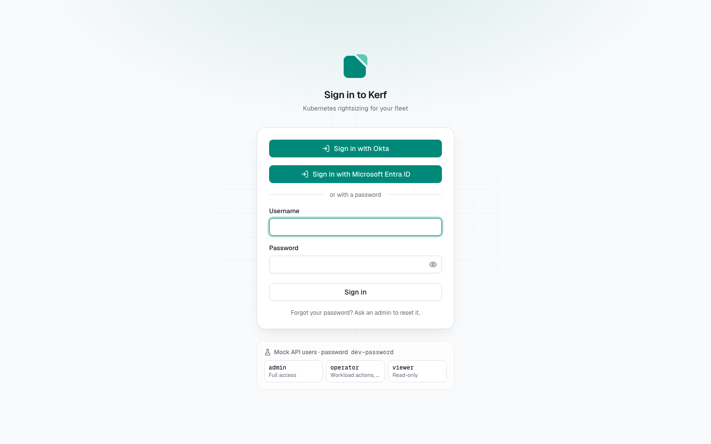
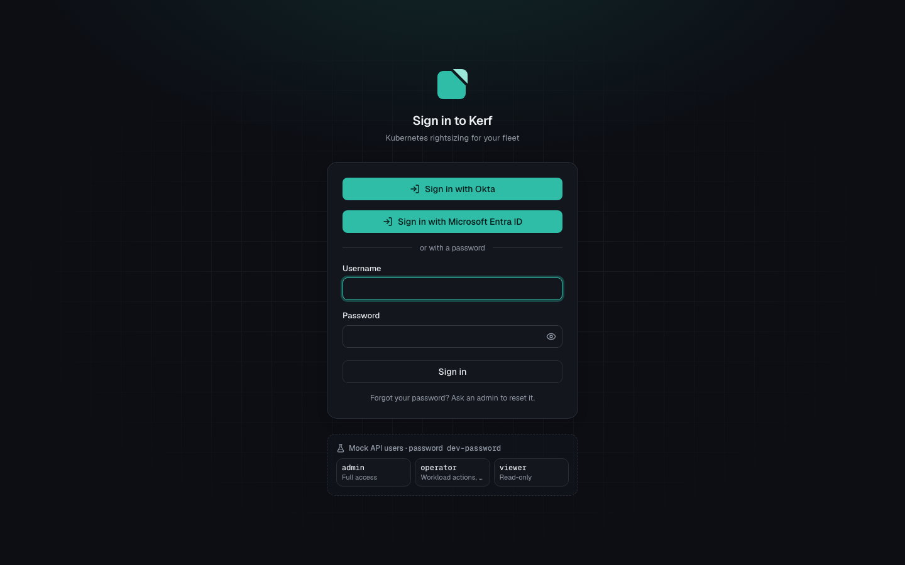
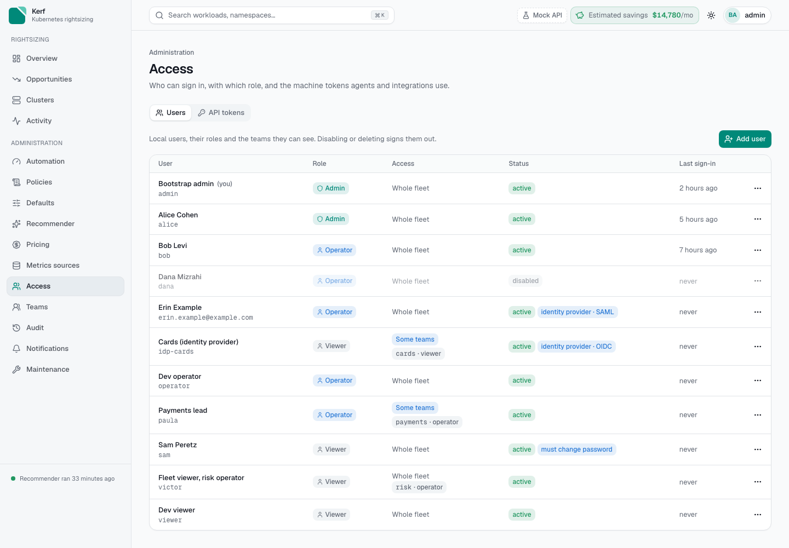

# Sign-in and access

Kerf shows a map of your production clusters: workloads, namespaces, costs and who changed what. So
**signing in is always required**. A browser without a session sees only the sign-in page, and the API
answers `401` to everything except sign-in itself.

- [How it works](#how-it-works)
- [Users and roles](#users-and-roles)
- [Sign in with OpenID Connect](#sign-in-with-openid-connect)
  - [Provider settings](#provider-settings): [Dex](#dex), [Keycloak](#keycloak), [Okta](#okta),
    [Microsoft Entra ID](#microsoft-entra-id), [Google](#google)
- [Sign in with SAML](#sign-in-with-saml)
  - [IdP settings](#idp-settings): [Okta](#okta-saml), [Microsoft Entra ID](#microsoft-entra-id-saml),
    [Keycloak](#keycloak-saml)
  - [Moving from Dex to native SAML](#moving-from-dex-to-native-saml)
- [Sign-in protection](#sign-in-protection)
- [Automation: bearer tokens](#automation-bearer-tokens)
- [Behind a load balancer](#behind-a-load-balancer)
- [Upgrading from anonymous read access](#upgrading-from-anonymous-read-access)
- [Troubleshooting](#troubleshooting)

## How it works

```
browser ──(kerf_session cookie only)──► web (nginx) ──(the cookie, nothing else)──► hub
curl / CI / agents ──(Authorization: Bearer <token>)─────────────────────────────► hub
```

- **Sign-in.** `POST /v1/auth/login` checks the username and password and sets the session cookie
  `kerf_session` (`HttpOnly`, `SameSite=Strict`, `Path=/`, and `Secure` behind TLS). The hub stores only a
  SHA-256 of the session token. Every write made with a session also needs the `X-CSRF-Token` header,
  which the UI gets at sign-in.
- **The web proxy holds no token.** nginx forwards only the `kerf_session` cookie to the hub (and, during a sign-in
  with an identity provider, its `kerf_oidc` or `kerf_saml` state cookie). It never
  forwards a browser's `Authorization` header and never adds credentials of its own, so a visitor without
  a session reads nothing.
- **The UI checks the session first.** Until `GET /v1/me` answers, the UI shows a neutral loading screen:
  no navigation, no numbers, no requests for data. Without a session it shows the sign-in page, and after
  sign-in it returns to the page you asked for (`/login?next=/opportunities`). `next` only accepts paths of
  the same site; a link to another site goes to the overview instead.
- **Session end.** A session lasts `hub.auth.sessionTTL` (default `12h`). When it expires or is revoked
  (sign-out in another tab, a password change, an admin disabling the user), the next request, or at the
  latest the check at the session's end time, brings the UI back to the sign-in page with the notice
  "Your session ended". After sign-in you are back on the page you were on.
- **Sign-out** revokes the session on the hub and clears the cookie, also when the session had already
  ended.
- **Every `/v1` endpoint needs credentials**, a session or a bearer token, except sign-in and sign-out.
  The probes (`/healthz`, `/readyz`) and `/metrics` are outside `/v1`. A test in the hub
  (`internal/hub/server_routes_test.go`) lists every route and fails when a new one answers without
  credentials.

## Users and roles

| Role | Can (each includes the ones above) |
|---|---|
| `viewer` | read everything the UI shows: workloads, recommendations, savings, clusters, policies, settings, the audit log |
| `operator` | workload overrides and exclusions, approve once, pause a cluster or the fleet, impact previews |
| `admin` | defaults and policies, recommender and pricing settings, clusters, tokens, users |

- **The first admin** (`admin`) is created on an empty database (`hub.auth.bootstrapAdmin`). If you give
  no password, the chart generates one, once, in the Secret `<hub name>-bootstrap-admin` (key `password`;
  `hub-bootstrap-admin` for a release named `kerf`), and the admin **must choose a new password at the
  first sign-in**. The install NOTES show the command that reads it. A password you supply yourself
  (`existingSecret` or `externalSecret`, see [Install on Amazon EKS](install/eks.md), section 4.5) is not
  forced: you already chose it. With `generate: false` and no password there is no bootstrap admin. The
  generated password uses Helm `lookup`, so with Argo CD or `helm template` supply your own.
- **More users:** *Admin → Access → Users*. A new user gets a temporary password and must change it at the
  first sign-in. An admin can disable a user (their sessions end at once) or reset a password.
- Everyone who needs to see Kerf needs a user, at least a `viewer`. With an identity provider the
  users come from there: [OpenID Connect](#sign-in-with-openid-connect) or [SAML](#sign-in-with-saml).

## Sign in with OpenID Connect

Kerf signs people in with your identity provider (IdP): Okta, Microsoft Entra ID, Google, Keycloak, Dex
or any other OpenID Connect provider. The sign-in page then shows **Sign in with &lt;name&gt;** above the
password form.

- **Flow.** Authorization code flow with PKCE, `state` and `nonce`. The hub verifies the ID token (issuer,
  audience, signature, expiry, nonce). The sign-in is bound to the browser that started it (the `kerf_oidc`
  cookie, 10 minutes, one use).
- **Users.** The first sign-in creates a Kerf user named after the e-mail address (`usernameClaim`, default
  `email`, lowercased), linked to the provider's subject. The audit log names it by that e-mail, and every
  action it takes records the IdP **subject and e-mail** (`actor.subject`, `actor.email`). Admin → Access
  lists these users as IdP users: they have no password, and their role is not edited in Kerf.
- **Roles from groups.** `roleMappings` map the groups claim (default `groups`) to roles; the highest
  matching role wins. With no match the user gets `defaultRole`, or, if it is empty, the sign-in is denied
  ("No access to Kerf"). A mapping with `teams: [...]` gives its role on those teams only
  ([Teams](teams.md#sign-in-with-an-identity-provider)).
- **Removing access.** The hub re-reads the groups with the refresh token every `refreshInterval` (default
  `5m`), during the user's next request. Removed from a mapped group: the role drops at that refresh.
  Removed from every mapped group, deactivated at the IdP, or the refresh token revoked: the session ends
  and the browser goes to the sign-in page. Disabling the user in Kerf ends its sessions at once.
- **No refresh token** (the provider did not grant `offline_access`): the session lasts one
  `refreshInterval`, and the next sign-in reads the groups again.
- **Session.** An IdP session is a normal Kerf session (`sessionTTL`, sign-out, CSRF). Signing out of Kerf
  does not sign you out of the IdP.
- **Secrets.** The client secret comes from a Kubernetes Secret. The refresh tokens the hub keeps are
  encrypted (AES-256-GCM, key derived from the client secret); no ID, access or refresh token is ever
  logged. A new client secret ends the IdP sessions at their next refresh.
- **Provider down.** Sign-in shows "Cannot reach &lt;name&gt;". Signed-in users keep their role until the
  provider answers again (each refresh waits at most 15 seconds). Use the break-glass admin below.

Chart values (the component chart's `auth.*`; with the kerf chart, `hub.auth.*`):

```yaml
hub:
  auth:
    oidc:
      enabled: true
      name: Okta                      # "Sign in with Okta"
      issuer: https://example.okta.com/oauth2/default
      clientID: 0oa1example
      redirectURL: https://kerf.example.com/v1/auth/oidc/callback   # the UI's host
      # scopes: [openid, profile, email, offline_access]            # the default
      groupsClaim: groups
      usernameClaim: email
      roleMappings:
        - {group: platform-admins, role: admin}
        - {group: platform, role: operator}
        - {group: engineering, role: viewer}
      defaultRole: ""                 # "" denies users without a mapped group
      refreshInterval: 5m
      clientSecret:                   # one of:
        existingSecret: kerf-oidc     #   a Secret you create (key client-secret)
        # externalSecret: {enabled: true, remoteRef: {key: kerf/hub/oidc, property: clientSecret}}
    local:
      enabled: false                  # optional: passwords only for the break-glass admin
```

Register the redirect URL with the provider exactly as written, on the host users open (the web UI), not
the hub's API host.

When the hub reaches the provider by another address than browsers do (split-horizon DNS, a provider only
published on an internal load balancer), set `connectAddress: <host>:<port>`: the hub connects there for the
issuer's host, while URLs, the `Host` header and TLS names stay the issuer's. The development environment
uses it for its Dex (issuer `http://localhost:15556/dex`, which is the hub pod itself from inside it).

### Break-glass admin

With `auth.local.enabled: false` nobody signs in with a password except one break-glass admin
(`auth.local.breakGlassUser`, default the bootstrap admin, `admin`), for when the IdP is down or
misconfigured. The sign-in page hides the password form behind **Administrator sign-in with a password**.
Every other password sign-in gets the answer of a wrong password. Keep that admin's password in your
secrets manager and rotate it after use.

### Provider settings

Every provider needs a confidential **web** client (with a client secret), the authorization code grant,
the refresh token grant, and the redirect URL `https://<UI host>/v1/auth/oidc/callback`.

#### Dex

Tested (the e2e suite, against the development environment's Dex v2.45.1: `dev/manifests/hub/dex.yaml`).

```yaml
# Dex config
staticClients:
  - id: kerf
    name: Kerf
    secretEnv: KERF_CLIENT_SECRET
    redirectURIs: [https://kerf.example.com/v1/auth/oidc/callback]
```
```yaml
# Kerf
issuer: https://dex.example.com/dex
clientID: kerf
scopes: [openid, profile, email, groups, offline_access]
```
Dex passes the groups of its connector (LDAP, GitHub teams, SAML, Google Workspace, ...). Dex v2.46.0 and
v2.46.1 hang on the first refresh with the `memory` and `sqlite3` storages (fixed in neither yet); use
v2.45.x, or the `postgres` or `kubernetes` storage.

#### Keycloak

Tested (Keycloak 26.4).

1. In your realm, **Clients → Create client**: OpenID Connect, client ID `kerf`; **Client authentication**
   on; **Standard flow** on; **Valid redirect URIs** `https://kerf.example.com/v1/auth/oidc/callback`.
   Copy the secret from **Credentials**.
2. **Client scopes → kerf-dedicated → Add mapper → By configuration → Group Membership**: name `groups`,
   token claim name `groups`, **Full group path** off, add to ID token and userinfo.
3. Users need an e-mail address (the username) and the realm's `offline_access` role (a default role).

```yaml
issuer: https://keycloak.example.com/realms/<realm>
clientID: kerf
# scopes: the default (openid, profile, email, offline_access)
```

#### Okta

1. **Applications → Create App Integration**: OIDC, **Web Application**; grant types **Authorization Code**
   and **Refresh Token**; sign-in redirect URI `https://kerf.example.com/v1/auth/oidc/callback`; assign the
   groups that may use Kerf.
2. **Security → API → Authorization Servers → default → Claims → Add Claim**: name `groups`, include in
   **ID Token** (Always), value type **Groups**, filter e.g. *Matches regex* `.*` (or *Starts with*
   `platform`).

```yaml
issuer: https://<your-org>.okta.com/oauth2/default
clientID: <client ID>
```

#### Microsoft Entra ID

1. **App registrations → New registration**: redirect URI (platform **Web**)
   `https://kerf.example.com/v1/auth/oidc/callback`. **Certificates & secrets → New client secret.**
2. **Token configuration → Add groups claim**: Security groups, ID token: **Group ID**. Entra sends group
   **object IDs**, so `roleMappings` use the IDs. A user in more than 200 groups gets no groups claim: set
   **Enterprise application → Properties → Assignment required** and send only *Groups assigned to the
   application*.
3. **API permissions:** `openid`, `profile`, `email`, `offline_access` (Microsoft Graph, delegated).

```yaml
issuer: https://login.microsoftonline.com/<tenant ID>/v2.0
clientID: <application (client) ID>
usernameClaim: preferred_username    # the UPN; email is often empty
roleMappings:
  - {group: 6a1c0b5e-0000-4000-8000-000000000001, role: admin}   # object ID of platform-admins
```

#### Google

Google's ID token has **no groups claim**.

- To map Google Workspace groups, put Dex in front of Google (Dex's `google` connector reads the groups
  with a service account) and configure Kerf for Dex.
- To sign in with Google directly, make the OAuth client's consent screen **Internal** (only your Workspace
  users can sign in) and give everyone one role with `defaultRole`.

```yaml
issuer: https://accounts.google.com
clientID: <client ID>.apps.googleusercontent.com
scopes: [openid, profile, email]          # Google refuses offline_access as a scope...
authParams: {access_type: offline, prompt: consent}   # ...and gives a refresh token this way
defaultRole: viewer
```

## Sign in with SAML

Kerf is also a SAML 2.0 service provider (SP), for identity providers that offer SAML only, or where OIDC is turned
off for some apps: Okta, Microsoft Entra ID, Keycloak, AD FS, PingFederate, Google Workspace and others. No extra
component is needed. The sign-in page shows **Sign in with &lt;name&gt;** above the password form, next to the OIDC
button when both are configured.

| Light | Dark |
|---|---|
|  |  |

- **Flow.** SP-initiated: `/v1/auth/saml/login` sends the browser to the IdP with an `AuthnRequest`
  (HTTP-Redirect binding, signed when you give the SP a key) and a random `RelayState`. The IdP posts its response
  to the assertion consumer service (ACS) `/v1/auth/saml/acs` (HTTP-POST binding). IdP-initiated sign-ins (from
  the IdP's app dashboard) are refused: start at Kerf, or point the IdP's tile at
  `https://kerf.example.com/v1/auth/saml/login`.
- **What the hub checks.** The XML signature against the IdP's certificate from its metadata (only what the
  signature covers is read, so a wrapped or tampered response is refused), the issuer, the audience (Kerf's entity
  ID), the destination, that the response answers the request this browser started (`InResponseTo`), and
  `NotBefore`, `NotOnOrAfter` and the issue instant, with `clockSkew` (default `3m`) of leeway.
- **Signed assertions.** By default the **assertion** must be signed. With `requireSignedAssertions: false` a signed
  response around an unsigned assertion is accepted too. An unsigned response with an unsigned assertion is always
  refused.
- **Replay.** Each accepted assertion ID is kept in PostgreSQL until the assertion expires, so every hub replica
  refuses a second use.
- **Bound to the browser.** The `RelayState` is also kept in the `kerf_saml` cookie (`HttpOnly`, `SameSite=Lax`,
  `Path=/v1/auth/saml`, 10 minutes, one use). The IdP's POST is cross-site, so it carries no such cookie: the ACS
  only verifies the response and stores the identity, then sends the browser on to `/v1/auth/saml/finish`, which
  starts the session only in the browser holding the cookie of that sign-in.
- **Users.** The first sign-in creates a Kerf user named after the `email` attribute (`usernameAttribute`,
  lowercased; when the attribute is missing and the NameID is an e-mail address, the NameID), linked to the IdP's
  entity ID and the **NameID**. The NameID must be stable (`persistent`, `emailAddress` or the username); a
  `transient` NameID is refused. The audit log records the IdP subject (the NameID) and e-mail of every action, as
  for OIDC. Admin → Access shows these users as **identity provider · SAML**: no password, and their role is not
  edited in Kerf.

  
- **Roles from groups.** `roleMappings` map the `groups` attribute (`groupsAttribute`) to roles exactly like the OIDC
  mappings: the highest matching role wins, `teams: [...]` gives team roles, and without a match `defaultRole`
  applies or the sign-in is denied.
- **Removing access.** A SAML IdP has no refresh token, so the groups are read at **each sign-in**. A user moved to
  another group gets the new role at the next sign-in (all its sessions follow, since the role is the user's). A
  user removed from every mapped group is refused at the next sign-in, and its other sessions end at that moment.
  Until then a session lasts `hub.auth.sessionTTL` (default `12h`), or less when the IdP sets
  `SessionNotOnOrAfter`. To cut access at once, disable the user in Admin → Access; lower `sessionTTL` to make the
  next sign-in come sooner.
- **Session.** A SAML session is a normal Kerf session: `kerf_session` cookie, `X-CSRF-Token`, `sessionTTL`,
  sign-out. Signing out of Kerf does not sign you out of the IdP (no single logout).
- **Secrets.** The optional SP key and the IdP metadata come from Kubernetes Secrets; neither is logged or returned
  by the API. The hub logs why a response was refused, never the response itself.
- **IdP down.** The hub reads the IdP's metadata at the first sign-in and every `metadataRefreshInterval` (default
  `24h`); a failed refresh keeps the metadata it has. Without any, the sign-in page shows "Cannot reach
  &lt;name&gt;". Signed-in users are not affected. Keep the [break-glass admin](#break-glass-admin).

Chart values (the component chart's `auth.*`; with the kerf chart, `hub.auth.*`):

```yaml
hub:
  auth:
    saml:
      enabled: true
      name: Okta                       # "Sign in with Okta"
      acsURL: https://kerf.example.com/v1/auth/saml/acs        # the UI's host
      # entityID: https://kerf.example.com/v1/auth/saml/metadata  # the default: the SP metadata URL
      idpMetadataURL: https://example.okta.com/app/exk1example/sso/saml/metadata
      # or the metadata XML from a Secret you create (key metadata.xml):
      # idpMetadataSecret: {existingSecret: kerf-saml-idp}
      usernameAttribute: email
      groupsAttribute: groups
      roleMappings:
        - {group: platform-admins, role: admin}
        - {group: platform, role: operator}
        - {group: engineering, role: viewer}
      defaultRole: ""                  # "" denies users without a mapped group
      # requireSignedAssertions: true  # the default
      # clockSkew: 3m
      # Optional: sign the authentication requests (and decrypt encrypted assertions) with this key.
      # spKeySecret: {existingSecret: kerf-saml-sp}             # a kubernetes.io/tls Secret
    local:
      enabled: false                   # optional: passwords only for the break-glass admin
```

- **Kerf's SP metadata** is at `https://kerf.example.com/v1/auth/saml/metadata` (public). Import it at the IdP, or
  enter its two values by hand: the **entity ID** (also called Audience URI or Identifier) and the **ACS URL**
  (Single sign-on URL, Reply URL). Both are on the host users open (the web UI), not the hub's API host.
- **The IdP's metadata.** `idpMetadataURL` must be `https`; `allowHTTPMetadata: true` accepts `http` for a network
  you trust (whoever can change the metadata in transit chooses the signing certificate). With an aggregate
  (several entities), set `idpEntityID`.
- **An SP key** is optional: create it with
  `openssl req -x509 -newkey rsa:3072 -nodes -days 1095 -subj /CN=kerf-saml -keyout tls.key -out tls.crt` and
  `kubectl create secret tls kerf-saml-sp --key tls.key --cert tls.crt`. The hub then signs its requests and
  publishes the certificate in its metadata; turn on "requests must be signed" at the IdP after importing it.

### IdP settings

Every IdP needs: the ACS URL `https://kerf.example.com/v1/auth/saml/acs` with the HTTP-POST binding, the audience
(entity ID) `https://kerf.example.com/v1/auth/saml/metadata`, a stable NameID, **signed assertions**, and the
attributes `email` and `groups` (or point `usernameAttribute` and `groupsAttribute` at the names the IdP uses).

<a id="okta-saml"></a>

#### Okta

1. **Applications → Create App Integration → SAML 2.0.** **Single sign-on URL**: the ACS URL (keep **Use this for
   Recipient URL and Destination URL**). **Audience URI (SP Entity ID)**: the entity ID. **Name ID format**:
   Persistent (or EmailAddress); **Application username**: Email.
2. **Attribute Statements:** `email` = `user.email`, `displayName` = `user.displayName`. **Group Attribute
   Statements:** name `groups`, filter e.g. *Matches regex* `.*` (or *Starts with* `platform`).
3. Okta signs the assertion by default. Assign the groups that may use Kerf, then copy the **Metadata URL** from the
   **Sign On** tab.

```yaml
idpMetadataURL: https://<your-org>.okta.com/app/<app id>/sso/saml/metadata
nameIDFormat: persistent
```

<a id="microsoft-entra-id-saml"></a>

#### Microsoft Entra ID

1. **Enterprise applications → New application → Create your own application** (non-gallery) → **Single sign-on →
   SAML.** **Identifier (Entity ID)**: the entity ID. **Reply URL (Assertion Consumer Service URL)**: the ACS URL.
2. **Attributes & Claims.** **Unique User Identifier (Name ID)**: `user.objectid`, format Persistent. **Add a group
   claim**: Security groups, source attribute **Group ID**. Entra sends group **object IDs**, so `roleMappings` use
   the IDs, and its claims have URI names (below). A user in more than 150 groups gets no groups in the assertion:
   send only *Groups assigned to the application*.
3. **SAML Certificates.** Signing option **Sign SAML assertion** (the default). Copy the **App Federation Metadata
   Url**. Assign the users or groups that may use Kerf.

```yaml
idpMetadataURL: https://login.microsoftonline.com/<tenant ID>/federationmetadata/2007-06/federationmetadata.xml?appid=<application ID>
usernameAttribute: http://schemas.xmlsoap.org/ws/2005/05/identity/claims/name           # the UPN
emailAttribute: http://schemas.xmlsoap.org/ws/2005/05/identity/claims/emailaddress
groupsAttribute: http://schemas.microsoft.com/ws/2008/06/identity/claims/groups
roleMappings:
  - {group: 6a1c0b5e-0000-4000-8000-000000000001, role: admin}   # object ID of platform-admins
```

<a id="keycloak-saml"></a>

#### Keycloak

Tested (the e2e suite, against the development environment's Keycloak 26.8: `dev/manifests/hub/keycloak.yaml`).

1. In your realm, **Clients → Create client**: client type **SAML**, **Client ID** = the entity ID. **Valid redirect
   URIs**: the ACS URL, and the same under **Advanced → Assertion Consumer Service POST Binding URL**. **Name ID format** `persistent` with
   **Force name ID format** on. **Signature and Encryption:** **Sign documents** and **Sign assertions** on
   (Keycloak signs only the document by default; Kerf wants the assertion signed).
2. **Keys:** **Client signature required** off (on, with Kerf's certificate, when you give Kerf an SP key).
3. **Client scopes → &lt;client&gt;-dedicated → Add mapper → By configuration:** **User Property** `email` → SAML
   attribute name `email`; **Group list** → attribute name `groups`, **Full group path** off.

```yaml
idpMetadataURL: https://keycloak.example.com/realms/<realm>/protocol/saml/descriptor
nameIDFormat: persistent
```

### Moving from Dex to native SAML

Earlier, a SAML-only IdP needed Dex as a bridge (Dex's SAML connector, Kerf on OIDC). To drop Dex:

1. Configure `auth.saml` for the IdP as above, next to `auth.oidc`, and check a sign-in with an account that has no
   Kerf user yet.
2. Kerf never gives the name of a live user of one provider to another: users Dex created sign in with SAML only
   after an admin deletes them in Admin → Access ("This account name is taken" until then). Their audit history
   stays; the next SAML sign-in creates the user again from the IdP's groups.
3. Remove `auth.oidc` and Dex. Sessions that came through Dex end at their next refresh.

## Sign-in protection

- **One answer for every failure.** A wrong password, an unknown user, a disabled user and a locked user
  all get `401` `invalid_credentials`, "Wrong username or password.", after the same password-hashing
  work. Nothing in the answer or its timing tells whether a username exists.
- **Lockout.** After `hub.auth.maxFailedLogins` failures in a row (default 5) a user is locked for
  `hub.auth.lockoutDuration` (default `15m`). While locked, even the right password fails with the same
  answer. An admin's password reset unlocks the user.
- **Rate limits.** At most `hub.auth.loginRateLimit` sign-in attempts per minute per username (default 10)
  and three times that per client address. Beyond them the hub answers `429` `rate_limited`, "Too many
  sign-in attempts. Try again later.", with `Retry-After`. The limits are counted by each hub replica.

## Automation: bearer tokens

Scripts, CI jobs, the pricing service and the agents call the hub API with a bearer token, unchanged:

```bash
curl -sS -H "Authorization: Bearer $KERF_TOKEN" https://<hub>/v1/workloads?limit=10
```

Create tokens in *Admin → Access → Tokens* (shown once). Roles: `ui` (read-only, counts as `viewer`),
`admin`, `pricing`, and `agent` (one cluster). Call the hub directly (its Service or ingress); the web
proxy is for browsers and does not forward `Authorization`.

## Behind a load balancer

The hub limits sign-in attempts per client address. It takes the address from the **last**
`X-Forwarded-For` entry, the one added by the proxy right in front of it; entries a client sends itself are
ignored. The web nginx replaces `X-Forwarded-For` with the client it sees.

Behind an ALB or an ingress controller that client is the load balancer, so all users would share one
limit. List the load balancer's addresses in the web chart's `trustedProxies` (the kerf chart:
`web.trustedProxies`), and nginx takes the client from the entry the load balancer appends:

```yaml
web:
  trustedProxies: [10.0.0.0/16]   # the ALB subnets, or the VPC CIDR
```

Keep the range as narrow as you can: a client inside a trusted range that reaches nginx directly could
choose its own address.

## Upgrading from anonymous read access

Earlier versions showed the whole UI read-only to visitors without a session: the web proxy added a
shared `ui` token (`web.auth.anonymousRead: true`, the default). That is gone, with no switch to bring it
back.

1. **Give every reader a user.** People who used the UI without signing in need a `viewer` user
   (*Admin → Access → Users*).
2. **Remove the old values.** Delete `web.auth.anonymousRead` and `web.token` (with the component chart:
   `auth.anonymousRead` and `token`) from your values. The chart refuses to render while they are set:

   ```
   Error: execution error at (kerf/charts/web/templates/deployment.yaml:2:4): auth.anonymousRead
   (web.auth.anonymousRead in the kerf chart) was removed: Kerf always requires sign-in ...
   ```
3. **Clean up the token.** Revoke the `ui` token the proxy used in *Admin → Access → Tokens*, unless a
   script uses it. Delete its secret (`kerf/hub/ui-token` in Secrets Manager with the EKS guide); the
   chart no longer creates the `<web>-hub-token` Secret or ExternalSecret.
4. **Behind an ALB,** set `web.trustedProxies` (see above).

## Troubleshooting

- **"No access to Kerf" after signing in with the IdP.** None of the user's groups is in `roleMappings`
  and `defaultRole` is empty. Check the group names (Entra ID: object IDs) and `groupsClaim`; the hub logs
  `oidc sign-in denied: no mapped group` with the number of groups it got (0: the provider sends no groups
  claim, see the provider's settings above).
- **"This account name is taken".** A local user, or a user of the other identity provider, has the IdP user's
  name (`usernameClaim`, `usernameAttribute`). Rename or delete that user.
- **"The sign-in took too long".** More than 10 minutes at the provider, a second tab, or a browser that
  drops the `kerf_oidc` cookie. Start again.
- **"Cannot reach &lt;name&gt;".** The hub cannot read `<issuer>/.well-known/openid-configuration`: check
  `issuer` and the hub's egress (NetworkPolicy, proxy).

SAML (the hub logs the reason as `saml sign-in failed` with `err`; the response itself is never logged):

- **"Sign-in with &lt;name&gt; failed" and `expired` or `IssueInstant ... is in the future` in the log: clock skew.**
  The IdP's clock and the hub's differ by more than `clockSkew` (default `3m`). Fix the time (NTP) on the IdP side
  or the nodes; raise `clockSkew` (at most `10m`) only as a stopgap.
- **`AudienceRestriction does not contain ...`: wrong audience.** The IdP's entity ID / Audience URI / Identifier for
  Kerf is not Kerf's `entityID` (default `https://<UI host>/v1/auth/saml/metadata`, the exact string, scheme and
  path included).
- **`Destination does not match`.** The IdP posts to another ACS URL than `acsURL`: make both
  `https://<UI host>/v1/auth/saml/acs`.
- **"No access to Kerf": missing groups.** No `groups` attribute reached Kerf. The log line `saml sign-in denied: no
  mapped group` says how many groups arrived (0: add the group attribute or mapper at the IdP, or set
  `groupsAttribute` to the IdP's attribute name; Entra ID: the URI name and object IDs, above).
- **`the assertion is not signed (only the response is)`.** Turn on assertion signing at the IdP (Keycloak: **Sign
  assertions**), or set `requireSignedAssertions: false`.
- **`cannot validate signature`.** The IdP's signing certificate changed and the hub still has the old metadata:
  wait for `metadataRefreshInterval`, restart the hub, or update the metadata Secret.
- **`the NameID is transient`.** Choose a persistent or e-mail NameID at the IdP.
- **"The sign-in took too long".** More than 10 minutes at the IdP, an IdP-initiated sign-in, or a browser that drops
  the `kerf_saml` cookie. Start again from Kerf's sign-in page.
- **"Cannot reach &lt;name&gt;".** The hub cannot read the IdP's metadata (`idpMetadataURL`, or the Secret behind
  `idpMetadataSecret`): check the URL, `https`, and the hub's egress.

- **Every page shows the sign-in page right after signing in.** The session cookie does not come back.
  Behind plain HTTP the cookie must not be `Secure`: `hub.auth.cookieSecure: false` (development only).
  Behind TLS, check that nothing strips `Set-Cookie` or the `Cookie` header between the browser and nginx.
- **"Too many sign-in attempts" for everyone.** All users share one client address: set
  `web.trustedProxies`.
- **"Cannot reach the hub".** The UI could not check the session: the hub is down, or nginx cannot
  resolve `web.hub.upstream`. The UI shows nothing else until it can.
- **A script gets `401`.** It needs a bearer token, sent to the hub directly (not through the web proxy).
